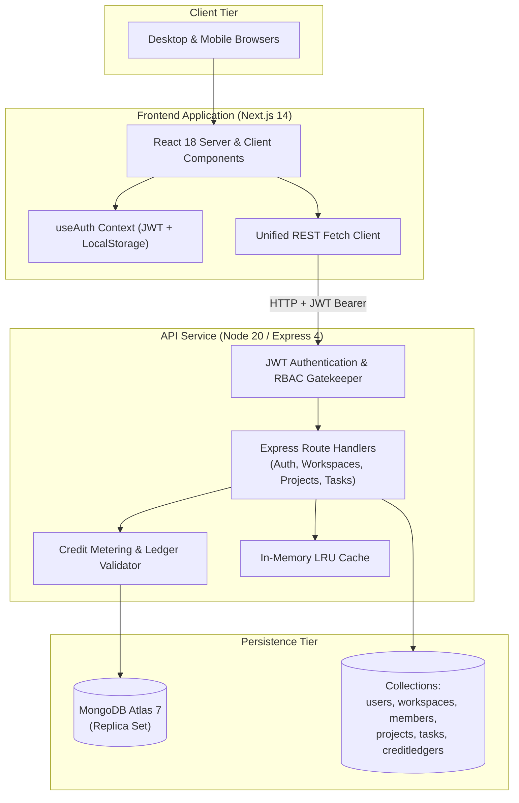
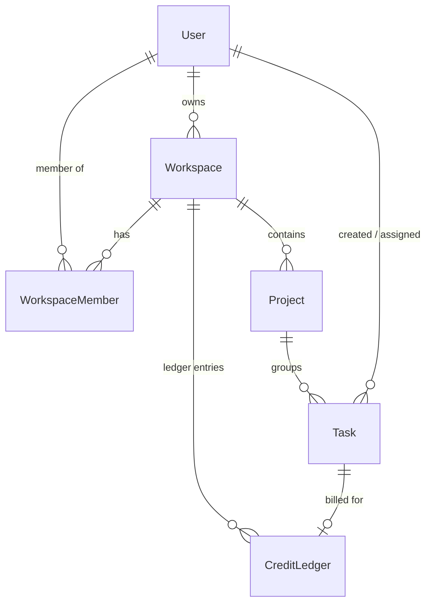
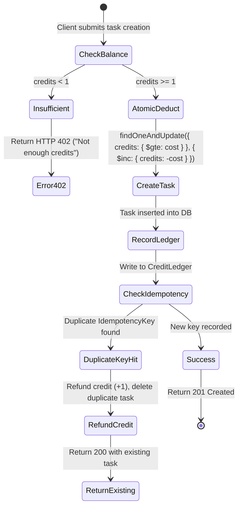

# Project Phoenix  Comprehensive System Documentation

> **Multi-tenant project tracker with usage-based credit metering and serverless deployment**

---

## Table of Contents
1. [Overview & Architecture](#1-overview--architecture)
2. [Quickstart & Local Development](#2-quickstart--local-development)
3. [Environment Configuration](#3-environment-configuration)
4. [Domain Model & Database Schema](#4-domain-model--database-schema)
5. [Complete REST API Reference](#5-complete-rest-api-reference)
6. [Frontend Architecture & User Journeys](#6-frontend-architecture--user-journeys)
7. [Credit Metering & Idempotency Specification](#7-credit-metering--idempotency-specification)
8. [Vercel Deployment Walkthrough](#8-vercel-deployment-walkthrough)
9. [CI/CD & Smoke Testing](#9-cicd--smoke-testing)
10. [Troubleshooting & FAQs](#10-troubleshooting--faqs)

---

## 1. Overview & Architecture

Project Phoenix is a modern, collaborative multi-tenant workspace and project tracking platform. Built for organizations requiring granular access control and usage-based economic models, Phoenix balances flexible collaborative workflows with strict data isolation.

### High-Level System Architecture



### Monorepo Structure

```
Phoenix/
├── phoenix-frontend/        # Next.js 14 (App Router) + React 18 + TypeScript
├── phoenix-backend/         # Express 4 + TypeScript + Mongoose 8
├── phoenix-ci/              # CI/CD workflows, Dependabot, and validation scripts
├── .github/workflows/       # GitHub Actions pipeline definition
├── docker-compose.yml       # Local development multi-container orchestration
├── DOCUMENTATION.md         # Comprehensive system manual
└── REPORT.md                # Triage, diagnosis, and remediation audit
```

---

## 2. Quickstart & Local Development

### Prerequisites
* **Node.js**: v20.x LTS (pinned via `.nvmrc`)
* **npm**: v10.x+
* **MongoDB**: Local MongoDB v7 instance or a free MongoDB Atlas cluster

---

### Option A: Running with Docker Compose (Recommended)

To spin up the database, backend, and frontend together:

```bash
# Build and launch all containers
docker-compose up --build

# In another terminal, seed demo accounts
docker-compose exec backend npm run seed -- --reset
```

* **Frontend**: `http://localhost:3000`
* **Backend API**: `http://localhost:8000`
* **MongoDB**: `localhost:27017`

---

### Option B: Running Bare-Metal Locally

#### 1. Setup Backend
```bash
cd phoenix-backend
npm ci
cp .env.example .env
# Edit .env with your MongoDB Atlas or local connection string
npm run build
npm run seed -- --reset
npm run dev
```

#### 2. Setup Frontend
```bash
cd ../phoenix-frontend
npm ci
cp .env.example .env.local
# Ensure NEXT_PUBLIC_API_URL=http://localhost:8000
npm run dev
```

---

### Default Demo Credentials

All test accounts come pre-seeded with the password: **`phoenix123`**

| Email | Role & Organization | Initial Credits |
|---|---|---|
| `alice@phoenix.dev` | Owner of **Acme Corp** | 3 Credits |
| `bob@phoenix.dev` | Member of **Acme Corp** | Shared Acme Balance |
| `carol@phoenix.dev` | Owner of **Globex Secret Lab** | 3 Credits |

---

## 3. Environment Configuration

### Backend (`phoenix-backend/.env`)

| Variable | Type | Required | Default | Description |
|---|---|---|---|---|
| `MONGODB_URI` | String | **Yes** | — | MongoDB connection string (starts with `mongodb://` or `mongodb+srv://`) |
| `JWT_SECRET` | String | **Yes** | — | Minimum 32-character string used for signing authentication tokens |
| `JWT_ALGORITHM` | String | No | `HS256` | JWT algorithm (`HS256`, `HS384`, `HS512`) |
| `JWT_EXPIRE_MINUTES` | Number | No | `120` | Token validity duration in minutes |
| `PORT` | Number | No | `8000` | HTTP listening port (overridden in serverless) |
| `CORS_ORIGINS` | String | No | `http://localhost:3000` | Allowed CORS origins (comma-separated or JSON array) |
| `TASK_CREDIT_COST` | Number | No | `1` | Credit cost deducted per created task |
| `WELCOME_CREDITS` | Number | No | `3` | Credits granted upon workspace creation |
| `APP_VERSION` | String | No | `dev` | Application version tag emitted in health checks |

### Frontend (`phoenix-frontend/.env.local`)

| Variable | Type | Required | Default | Description |
|---|---|---|---|---|
| `NEXT_PUBLIC_API_URL` | String | **Yes** | `http://localhost:8000` | Full base URL of the deployed Phoenix backend API |

---

## 4. Domain Model & Database Schema



### Data Dictionary

#### 1. `User`
* `_id` (`ObjectId`): Unique identifier.
* `email` (`String`, unique, indexed): Normalized lowercase email address.
* `passwordHash` (`String`): Bcrypt salted hash (cost factor: 10).
* `displayName` (`String`): User's visible name.
* `createdAt` (`Date`): Timestamp of account creation.

#### 2. `Workspace`
* `_id` (`ObjectId`): Unique identifier.
* `name` (`String`): Cleaned name of the organization.
* `owner` (`ObjectId` -> `User`): Workspace creator / administrator.
* `credits` (`Number`): Current non-negative credit balance.

#### 3. `WorkspaceMember`
* `workspace` (`ObjectId` -> `Workspace`): Reference to parent workspace.
* `user` (`ObjectId` -> `User`): Member identity.
* `role` (`String`): Permissions tier (`owner`, `admin`, `member`).
* *Index*: Compound unique index on `{ workspace: 1, user: 1 }`.

#### 4. `Project`
* `workspace` (`ObjectId` -> `Workspace`): Owning tenant workspace.
* `name` (`String`): Project title.
* `description` (`String`): Rich context description.

#### 5. `Task`
* `project` (`ObjectId` -> `Project`): Parent project.
* `title` (`String`): Task description.
* `status` (`String`): Lifecycle state (`todo`, `in_progress`, `done`).
* `createdBy` (`ObjectId` -> `User`): Author.
* `assignee` (`ObjectId` -> `User`, optional): Assigned workspace member.
* *Index*: Compound index on `{ project: 1, createdAt: -1, _id: -1 }`.

#### 6. `CreditLedger` (Append-Only Audit Trail)
* `workspace` (`ObjectId` -> `Workspace`): Billed tenant.
* `delta` (`Number`): Signed integer balance change (`+3` for welcome/top-up, `-1` for task).
* `reason` (`String`): Description of charge/grant.
* `task` (`ObjectId` -> `Task`, optional): Associated task ID.
* `idempotencyKey` (`String`, optional): Unique key preventing double charges.
* *Index*: Partial unique compound index on `{ workspace: 1, idempotencyKey: 1 }`.

---

## 5. Complete REST API Reference

All protected endpoints require an `Authorization: Bearer <JWT>` header.

### Authentication

#### `POST /api/auth/login`
Authenticates a user and issues a JSON Web Token.
* **Payload**:
  ```json
  {
    "email": "alice@phoenix.dev",
    "password": "phoenix123"
  }
  ```
* **Response `200 OK`**:
  ```json
  {
    "token": "eyJhbGciOiJIUzI1NiIsInR5cCI6IkpXVCJ9...",
    "user": {
      "id": "6724a91b2c4d9e001f3a8b01",
      "email": "alice@phoenix.dev",
      "display_name": "Alice Smith"
    }
  }
  ```

#### `GET /api/auth/me`
Retrieves identity profile of current bearer.
* **Response `200 OK`**: User profile object.

---

### System & Health

#### `GET /api/health`
Monitors cluster status and deployment version.
* **Response `200 OK`**:
  ```json
  {
    "status": "ok",
    "version": "1.0.0",
    "timestamp": "2026-10-31T07:50:00.000Z",
    "mongo": "connected"
  }
  ```

---

### Workspaces

#### `GET /api/workspaces`
Lists all workspaces where caller is an owner or member.
* **Response `200 OK`**: Array of workspace objects with `role` and `owner_id`.

#### `POST /api/workspaces`
Creates a new tenant workspace and seeds welcome credits.
* **Payload**: `{"name": "Engineering Alpha"}`
* **Response `201 Created`**: Returns created workspace with `owner` role.

#### `GET /api/workspaces/:workspaceId`
Fetches workspace metadata, membership count, and current credit balance.

#### `POST /api/workspaces/:workspaceId/topup`
*(Admin/Owner only)* Replenishes workspace credit balance.
* **Payload**: `{"amount": 10}`
* **Response `200 OK`**: Updated balance.

#### `GET /api/workspaces/:workspaceId/members`
Lists all members in the workspace with their roles.

#### `POST /api/workspaces/:workspaceId/members`
*(Admin/Owner only)* Invites or registers a user into the workspace.
* **Payload**: `{"email": "bob@phoenix.dev", "role": "member"}`

---

### Projects

#### `GET /api/workspaces/:workspaceId/projects`
Retrieves all projects contained within a workspace. Employs cached reads.

#### `POST /api/workspaces/:workspaceId/projects`
Creates a project under the specified workspace.
* **Payload**:
  ```json
  {
    "name": "Platform Modernization",
    "description": "Migrating monolithic stack to Next.js 14 and serverless"
  }
  ```

#### `GET /api/projects/:projectId`
Fetches single project metadata.

---

### Tasks & Metering

#### `GET /api/projects/:projectId/tasks`
Lists paginated tasks for a project. Supports search query and status filtering.
* **Query Parameters**:
  * `q` (string): Search query against title.
  * `status` (string): Filter by `todo`, `in_progress`, or `done`.
  * `page` (number, default: `1`).
  * `page_size` (number, default: `10`, max: `100`).
* **Response `200 OK`**:
  ```json
  {
    "items": [
      {
        "id": "6724a91b2c4d9e001f3a8b22",
        "project_id": "6724a91b2c4d9e001f3a8b10",
        "title": "Configure Vercel edge rewrite",
        "status": "in_progress",
        "created_by_id": "6724a91b2c4d9e001f3a8b01",
        "assignee_id": "6724a91b2c4d9e001f3a8b02",
        "created_at": "2026-10-31T07:30:00.000Z"
      }
    ],
    "total": 1,
    "page": 1,
    "page_size": 10
  }
  ```

#### `POST /api/projects/:projectId/tasks`
Creates a task. **Deducts 1 credit from workspace**.
* **Optional Header**: `Idempotency-Key: <unique-uuid-or-token>`
* **Payload**:
  ```json
  {
    "title": "Refactor database connection pool",
    "status": "todo",
    "assignee_id": "6724a91b2c4d9e001f3a8b02"
  }
  ```
* **Status Codes**:
  * `201 Created`: Task created, credit deducted.
  * `200 OK`: Duplicate idempotency key received; previously generated task returned without re-billing.
  * `402 Payment Required`: Insufficient workspace credits (`"Not enough credits"`).
  * `422 Unprocessable Entity`: Assignee does not belong to workspace.

---

## 6. Frontend Architecture & User Journeys

The frontend is implemented with Next.js 14 App Router:

```
phoenix-frontend/src/
├── app/
│   ├── layout.tsx                 # Root layout with AuthProvider & NavBar
│   ├── page.tsx                   # Landing redirect / home
│   ├── login/page.tsx             # Interactive authentication form
│   ├── workspaces/page.tsx        # Workspace picker & creation modal
│   ├── workspaces/[id]/page.tsx   # Workspace overview, project list, top-up
│   ├── workspaces/[id]/members/   # Member management & role assignment
│   └── projects/[id]/page.tsx     # Kanban board, task creation & filtering
├── components/
│   ├── NavBar.tsx                 # Global brand header with session display
│   ├── RequireAuth.tsx            # Route guard interceptor
│   └── Sidebar.tsx                # Contextual navigation sidebar
└── lib/
    ├── api.ts                     # Fetch client with token injection & cache
    └── auth.tsx                   # Auth React context provider
```

### Key User Flows
1. **Login & Session Storage**: User logs in with `alice@phoenix.dev` / `phoenix123`. Token is saved in `localStorage`.
2. **Workspace Dashboard**: Displays active balance (e.g. `Credits: 3`).
3. **Task Board**: Displays tasks grouped by column (`To Do`, `In Progress`, `Done`).
4. **Credit Warning & Top-Up**: When balance reaches `0`, task creation is disabled, prompting the user with a top-up modal.

---

## 7. Credit Metering & Idempotency Specification



---

## 8. Vercel Deployment Walkthrough

Deploying Phoenix to Vercel requires two separate project configurations from the same GitHub repository:

### Step 1: Deploy Backend (`phoenix-backend`)
1. In Vercel, click **Add New... > Project** and import `BhavyaAICE/Phoenix`.
2. Set **Root Directory** to `phoenix-backend`.
3. Set **Framework Preset** to `Other`.
4. Add Environment Variables:
   * `MONGODB_URI`: `mongodb+srv://<user>:<password>@cluster.mongodb.net/phoenix`
   * `JWT_SECRET`: Random 32+ character string
   * `CORS_ORIGINS`: `*`
5. Click **Deploy**. Note the assigned URL: `https://phoenix-backend-xxx.vercel.app`.

### Step 2: Deploy Frontend (`phoenix-frontend`)
1. Click **Add New... > Project** and import `BhavyaAICE/Phoenix` again.
2. Set **Root Directory** to `phoenix-frontend`.
3. Verify **Framework Preset** is set to `Next.js`.
4. Add Environment Variable:
   * `NEXT_PUBLIC_API_URL`: `https://phoenix-backend-xxx.vercel.app`
5. Click **Deploy**. Note the assigned URL: `https://phoenix-frontend-xxx.vercel.app`.

### Step 3: Seal CORS
Update `CORS_ORIGINS` in your backend Vercel settings to `https://phoenix-frontend-xxx.vercel.app` and trigger a redeployment.

---

## 9. CI/CD & Smoke Testing

Phoenix includes a GitHub Actions pipeline (`.github/workflows/pipeline.yml`) with automated stages:
* **`backend`**: Runs `npm ci`, typecheck, build, and tests against a MongoDB 7 service container.
* **`frontend`**: Runs `npm ci`, typecheck, and Next.js production build.
* **`e2e`**: Seeds test database, boots both apps in background, and executes `scripts/smoke.sh`.
* **`deploy`**: Automated production push to Vercel on `main` merge.
* **`verify`**: Executes smoke validation against the live deployment URL.

### Running Local Smoke Tests
```bash
./scripts/smoke.sh http://localhost:8000 http://localhost:3000
```
Outputs `SMOKE OK` upon complete end-to-end verification.

---

## 10. Troubleshooting & FAQs

### Q: Why do I get HTTP 402 when creating a task?
**A**: Each task costs 1 credit. Open the Workspace page (`/workspaces/:id`) and click **Top Up** to add credits to your balance.

### Q: Why do serverless functions timeout on cold starts?
**A**: Phoenix employs a cached connection singleton (`api/index.ts`) that reuses established MongoDB connections across lambda invocations. Ensure your MongoDB Atlas cluster has network access enabled (`0.0.0.0/0` or Vercel egress IPs).

### Q: Can a task be assigned to someone outside the workspace?
**A**: No. The backend validates that `assignee_id` exists in `WorkspaceMember` for the project's parent workspace, returning HTTP `422` otherwise.

